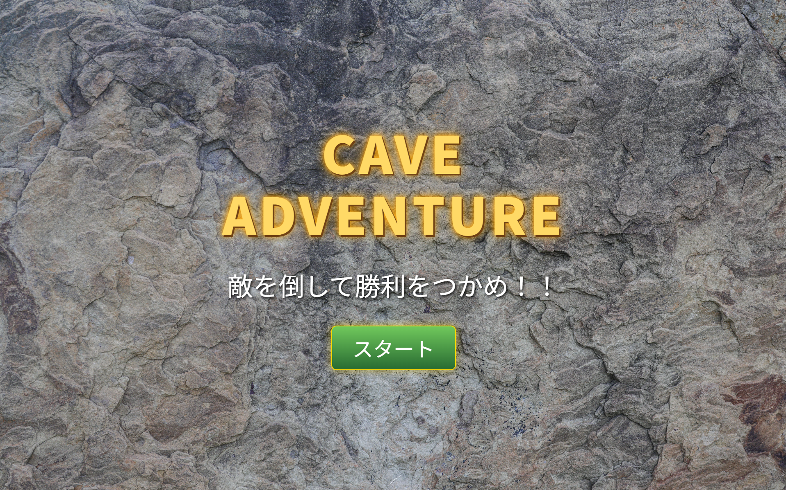
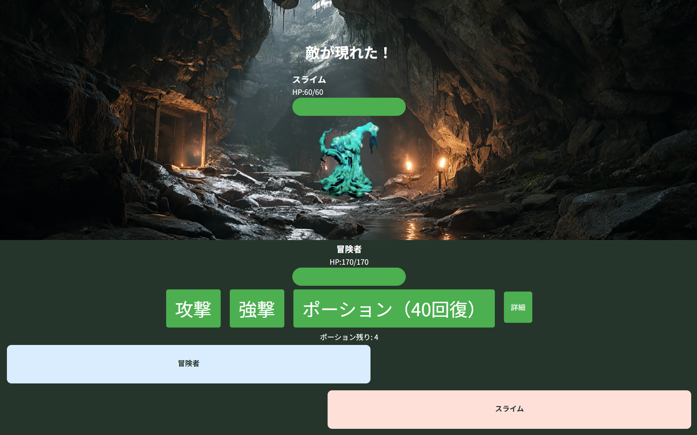
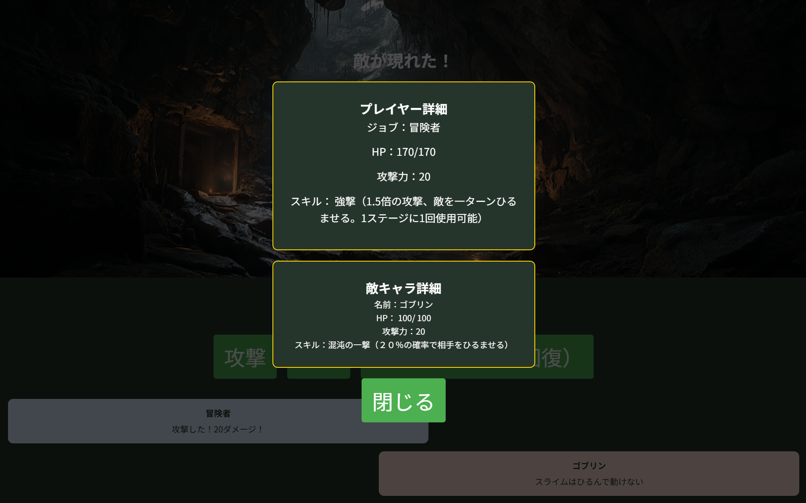
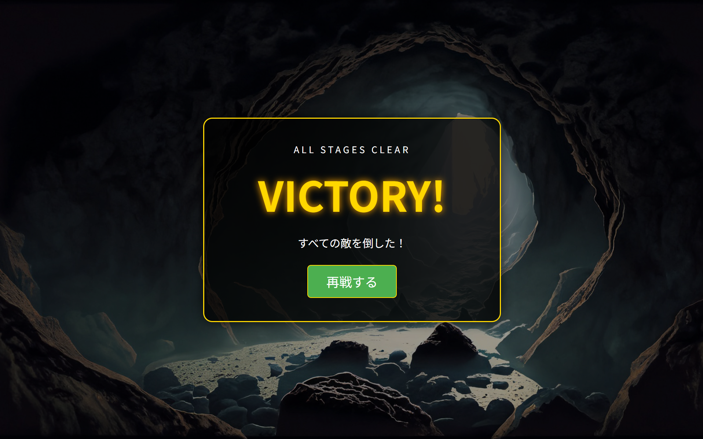

# CAVE ADVENTURE

## 🎮 ゲーム概要

JavaScriptで制作したターン制バトルRPGです。

プレイヤーは冒険者となり、スライム・ゴブリン・デーモンの3体の敵と戦います。

攻撃やスキル、ポーションを駆使して敵を倒し、全ステージクリアを目指します。

## 🛠 使用技術

- HTML
- CSS
- JavaScript

## ⚔️ 実装した機能

- ターン制バトル
- 通常攻撃・会心攻撃
- 強撃スキル（攻撃力1.5倍・敵を1ターンひるませる）
- ポーションによるHP回復
- 敵キャラクターごとの特殊能力
- HP管理・HPゲージ表示
- プレイヤーと敵の詳細情報表示
- 敵を倒すと次のステージへ進む機能
- 勝利・敗北画面
- リスタート機能
- レスポンシブ対応

## 📷 ゲーム画面

### タイトル画面

### 戦闘画面

### 詳細画面

### 勝利画面

## 📖 操作方法

画面に表示されるボタンをクリックしてゲームを進めます。

| ボタン | 内容 |
|---|---|
| 攻撃 | 敵に通常攻撃を行う |
| 強撃 | 強力な攻撃を行う |
| ポーション | HPを40回復する |
| 詳細 | プレイヤーと敵の情報を確認する |

## 👾 敵キャラクター

- **スライム**：一定確率で受けるダメージを半減する
- **ゴブリン**：一定確率でプレイヤーをひるませる
- **デーモン**：戦闘開始から4ターン目以降、攻撃力が2倍になる

## 📚 制作を通して学んだこと

- JavaScriptによるゲームの状態管理
- 関数を使った処理の整理
- オブジェクトを使ったデータ管理
- DOM操作による画面表示の切り替え
- イベントリスナーによるボタン操作
- CSSによるレイアウト調整とレスポンシブ対応